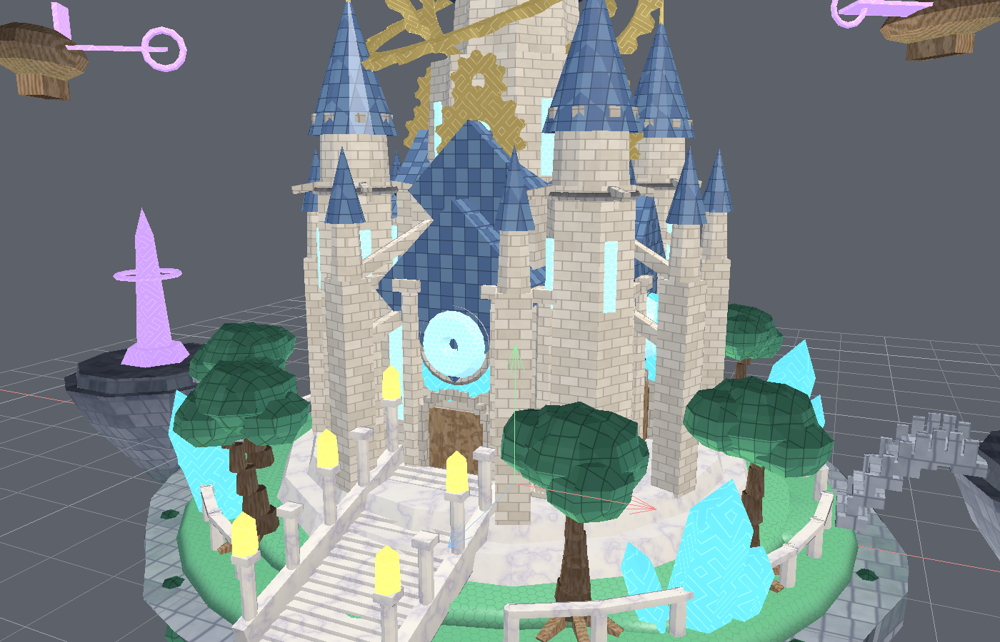

# 🤖 Rust AI 3D Modeler & Spatial Review Studio (`rust_modeler`)

An **AI-driven 3D Modeling, Voxel Sculpting & Spatial Review Studio** written in Rust (`wgpu` + `egui` + `winit`), featuring a built-in **Model Context Protocol (MCP) server** (`rust_modeler --mcp`) and an interactive **Smart Section Selection & Spatial Commenting GUI**.

Instead of forcing users to manually extrude vertices or wrestle with complex 3D gizmos, **Rust AI 3D Studio** implements an **AI-Agent-Driven 3D Workflow**:
1. **The AI Agent builds, sculpts, textures, and renders the 3D model** via MCP tools (`add_primitive`, `edit_mesh`, `sculpt_stroke`, `voxel_brush`, `voxel_remesh`, `set_material`, `capture_viewport`, `import_model`, `export_model`).
2. **The User inspects the 3D scene in the live GUI**, hovers and clicks to select one or more **connected 3D sub-parts** (`🧩 Sub-Part`), **crease-bounded surfaces/walls** (`📐 Smart Surface`), **whole layers** (`📦 Whole Layer`), or **painted regions** (`🖌 Paint Brush`)—even across multiple object layers at once—and attaches **Spatial 3D Comments** (or **General Scene Comments**).
3. **Any AI Agent (Claude Code, OpenAI Codex, Google Antigravity, Cursor)** queries `get_comments`, activates the user's exact 3D face selections via `select_comment_region`, applies the requested 3D modifications, visually verifies the result via `capture_viewport`, and marks the comment resolved with `resolve_comment`.

---

## 📸 Showcase: Clockwork Astral Cathedral & Floating Archipelago

Included out-of-the-box in [`assets/scenes/clockwork_astral_cathedral_scene.json`](assets/scenes/clockwork_astral_cathedral_scene.json) (~16,972 faces across 14 procedural & sculpted layers with tri-planar 3D shaders, emissive glow, and baked ambient occlusion / curvature wear):

| Wide Studio Render | Close-Up Architectural Detail |
| :---: | :---: |
|  |  |

---

## ✨ Key Features

### 1. 💬 AI-Driven Spatial Comment & Multi-Selection Workflow
- **4 Smart Selection Modes** (Top Bar & Shortcuts `1`–`4` / `Tab`):
  - **`🧩 Sub-Part (1)`** *(Default)*: **1-click selects the entire connected 3D piece** under the cursor (e.g., a single tree, gear, column, flying buttress, crystal, step, or airship inside a multi-part layer). Uses 2mm spatial vertex welding (`Mesh::quantize_pos`) so faceted meshes with split vertices select cleanly as a single 3D piece.
  - **`📐 Smart Surface (2)`**: **1-click flood-fills a contiguous wall, roof slope, step top, or smooth surface** bounded by sharp edges (`Crease: 5°..85°` slider).
  - **`📦 Whole Layer (3)`**: **1-click selects all faces of the clicked object layer**.
  - **`🖌 Paint Brush (4)`**: Click and drag across faces using an adjustable 3D sphere radius.
- **Live 3D Hover Preview**: Hovering over any part in `Sub-Part`, `Smart Surface`, or `Whole Layer` mode lights up the candidate selection in **electric cyan wireframe** before you click.
- **Multi-Selection for a Single Comment (`➕ Multi-Select`)**:
  - With `➕ Multi-Select` enabled (default), clicking multiple sub-parts or surfaces—**even across completely different object layers**—accumulates them into a single selection. Clicking an already-selected sub-part toggles it off.
  - Each selected section displays a **green 3D Pin Beacon** in the viewport and appears in the Right Panel's **Selected Sections** list with individual `✖` remove buttons.
  - Submitting a comment creates a `SpatialComment` containing `targets: Vec<CommentTargetSection>` with exact per-object `selected_faces`, 3D `world_anchor` / `local_anchor` coordinates, `surface_normal`, and local bounding boxes (`local_bounds_min` / `local_bounds_max`).
- **General Scene Comments (`🌐 Add General Comment`)**: Leave high-level instructions affecting the entire 3D model without pinning a specific surface.
- **Topological Grow / Shrink (`➕ Grow ]` / `➖ Shrink [`)**: Expand or contract any face selection by one ring of neighboring faces.

### 2. 🎨 Tri-Planar 3D Procedural Shaders, Emissive Materials & Vertex Baking
- **8 Real-Time WGSL Tri-Planar 3D Procedural Patterns** (`src/shader.wgsl` — no UV unwrapping required):
  - `none` (Solid / Vertex Color)
  - `checker` (3D Checkerboard Tiles)
  - `bricks` (Staggered Masonry Bricks with Mortar Grooves)
  - `stone_blocks` (Ashlar Castle Stone Blocks with Per-Block Variation)
  - `wood_grain` (Concentric Timber Rings & Fibrous Grain)
  - `marble` (Turbulent Veined Marble)
  - `hex_grid` (Arcane / Sci-Fi Hexagonal Lattice)
  - `rune_circuit` (Glowing Concentric Rune & Circuit Channels)
- **Automatic Mesh Ambient Occlusion & Curvature Edge Wear (`bake_ao_and_curvature`)**:
  - Computes per-vertex concavity/convexity from neighbor umbrellas and bakes dark crevice shading + highlighted worn ridges into vertex colors.
- **Directional Top-Coat & Height Gradient Painting (`paint_gradient_and_normal_coat`)**:
  - Automatically coats upward-facing normals (moss, snow, dust, gold trim) and vertical height gradients.
- **Emissive Glow (`emission_color`, `emission_strength`)**:
  - Full HDR-style emissive glow for lanterns, crystals, portals, and arcane rings.

### 3. 🔨 Polygonal Mesh Modeling, Dynamic-Topology Sculpting & SDF Voxel Engine (via MCP)
- **Polygonal Mesh Engine (`src/mesh.rs`)**:
  - Primitives: `cube`, `sphere`, `cylinder`, `plane`, `torus`, `voxel_sphere`.
  - Operations (`edit_mesh`): `extrude`, `inset`, `subdivide` (Catmull-Clark style quad/tri subdivision), `translate_selected`, `scale_selected`, `rotate_selected`, `delete_selected`, `select_by_normal`, `select_all`, `clear_selection`.
- **3D Surface Sculpting + Dynamic Topology (`src/voxel.rs`)**:
  - Brushes (`sculpt_stroke`): `draw`, `inflate`, `smooth`, `flatten`, `grab`, `pinch`, `crease` with X/Y/Z mirror symmetry and **Dyntopo** automatic local edge-split tessellation.
- **Volumetric SDF Voxel Engine (`src/voxel.rs`)**:
  - CSG operations (`voxel_brush`): `add_sphere`, `subtract_sphere`, `add_box`, `subtract_box`, `smooth_field`, `paint_color`.
  - Dual meshing modes: **Smooth Dual Surface Nets** (`smooth`) and **Blocky Voxel Cubes** (`blocky`), plus arbitrary-mesh **Voxel Remeshing** (`voxel_remesh`).
- **Headless & Live Viewport Screenshot Rendering (`capture_viewport`)**:
  - Renders the 3D scene via `wgpu` to a `.png` file so AI agents can visually inspect their work from any camera angle.
- **Import / Export (`.obj`, `.stl`, `.glb` glTF 2.0)**:
  - Full round-trip import and export in [`src/io.rs`](src/io.rs).

---

## 🚀 Quick Start

### Build & Run
```bash
# Run all unit tests
cargo test

# Launch the interactive 3D Studio GUI
cargo run
```

### Connect an AI Coding Agent via MCP

#### 1. Claude Code
This repository includes a root [`.mcp.json`](.mcp.json) and [`CLAUDE.md`](CLAUDE.md). When you open this directory in **Claude Code**, it will automatically detect the `rust-modeler` MCP server, or you can register it explicitly:
```bash
claude mcp add rust-modeler -- cargo run --quiet --manifest-path "/path/to/repo/Cargo.toml" -- --mcp
```

#### 2. OpenAI Codex / Cursor / Windsurf
Read [`AGENTS.md`](AGENTS.md) (automatically loaded by Codex and compatible agents). You can invoke any MCP tool either over stdio (`cargo run --quiet -- --mcp`) or directly from the shell via `--cmd`:
```bash
./target/debug/rust_modeler --cmd '{"tool":"get_comments","args":{}}'
./target/debug/rust_modeler --cmd '{"tool":"get_scene_info","args":{}}'
```

#### 3. Google Antigravity
Includes a pre-packaged Antigravity plugin in [`.agents/plugins/rust-modeler-mcp/`](.agents/plugins/rust-modeler-mcp/).

---

## 🛠 Complete MCP Tool Reference

| Tool Name | Purpose | Key Arguments |
| :--- | :--- | :--- |
| `get_scene_info` | Inspect all objects, transforms, materials, vertex/face counts, `unresolved_comments`, and `active_selection` | *(none)* |
| `get_comments` | List spatial & general comments left by the user, including `targets` (multi-part selections), 3D anchors, and face indices | `include_resolved?: bool`, `object_id?: int` |
| `select_comment_region` | Highlight all `targets` (`selected_faces`) of a `comment_id` and focus the camera | `comment_id: int`, `focus_camera?: bool` |
| `resolve_comment` | Mark a `comment_id` resolved and attach an `agent_reply` explaining the changes made | `comment_id: int`, `resolved?: bool`, `reply?: string` |
| `add_comment` | Programmatically add a spatial section comment or general scene comment | `comment: string`, `is_general?: bool`, `object_id?: int`, `local_point?: [x,y,z]`, `radius?: float` |
| `capture_viewport` | Render the 3D viewport to a PNG image file for AI visual self-inspection | `path?: string`, `width?: int`, `height?: int`, `yaw_deg?: float`, `pitch_deg?: float`, `distance?: float`, `target?: [x,y,z]`, `shading?: string` |
| `launch_gui_window` | Spawn the live 3D Modeler GUI window if not already open | *(none)* |
| `clear_scene` | Remove all objects from the scene (undoable) | *(none)* |
| `add_primitive` | Add a `cube`, `sphere`, `cylinder`, `plane`, `torus`, or `voxel_sphere` | `shape: string`, `name?: string`, `size?: float`, `radius?: float`, `height?: float`, `subdivisions?: int`, `position?: [x,y,z]`, `rotation_deg?: [x,y,z]`, `scale?: [x,y,z]`, `color?: [r,g,b]` |
| `transform_object` | Move, rotate, scale, rename, or show/hide an object | `object_id?: int`, `name?: string`, `position?: [x,y,z]`, `translate_delta?: [x,y,z]`, `rotation_deg?: [x,y,z]`, `scale?: [x,y,z]`, `new_name?: string`, `visible?: bool` |
| `set_material` | Set PBR material, 3D procedural shader `pattern`, emissive glow, and bake vertex AO / edge wear / top-coat | `object_id?: int`, `color?: [r,g,b]`, `secondary_color?: [r,g,b]`, `roughness?: float`, `metallic?: float`, `flat_shading?: bool`, `pattern?: string`, `texture_scale?: float`, `emission_color?: [r,g,b]`, `emission_strength?: float`, `bake_ao?: bool`, `ao_strength?: float`, `wear_strength?: float`, `top_coat_color?: [r,g,b]` |
| `edit_mesh` | Polygonal mesh modeling on selected faces or faces matching a normal | `object_id?: int`, `operation: string` (`extrude`, `inset`, `subdivide`, `translate_selected`, `scale_selected`, `rotate_selected`, `delete_selected`, `select_by_normal`, `select_all`, `clear_selection`), `select_faces?: int[]`, `select_faces_by_normal?: [x,y,z]`, `distance?: float`, `inset_factor?: float`, `delta?: [x,y,z]` |
| `sculpt_stroke` | Apply 3D sculpting brush (`draw`, `inflate`, `smooth`, `flatten`, `grab`, `pinch`, `crease`) with optional `dyntopo` | `object_id?: int`, `brush: string`, `point?: [x,y,z]`, `points?: [[x,y,z],...]`, `radius?: float`, `strength?: float`, `symmetry_x?: bool`, `dyntopo?: bool` |
| `voxel_brush` | Volumetric SDF CSG (`add_sphere`, `subtract_sphere`, `add_box`, `subtract_box`, `smooth_field`, `paint_color`) | `object_id?: int`, `operation: string`, `point?: [x,y,z]`, `points?: [[x,y,z],...]`, `radius?: float`, `color?: [r,g,b]`, `meshing_mode?: string` (`smooth` \| `blocky`) |
| `voxel_remesh` | Remesh any object into uniform topology at a target voxel grid resolution | `object_id?: int`, `resolution?: int` (`12..64`) |
| `set_camera_and_viewport` | Orbit/zoom camera, set view preset (`front`, `right`, `top`), or switch shading (`lit`, `clay`, `wireframe`) | `target?: [x,y,z]`, `distance?: float`, `yaw_deg?: float`, `pitch_deg?: float`, `preset?: string`, `shading?: string`, `wireframe_overlay?: bool`, `show_grid?: bool` |
| `import_model` / `export_model` | Import or export `.obj`, `.stl`, or `.glb` (glTF 2.0) files | `path: string`, `name?: string`, `color?: [r,g,b]` |
| `undo` / `redo` | Step backward or forward through the undo history | *(none)* |

---

## 📂 Architecture Overview

See [`AGENTS.md`](AGENTS.md) for a deep dive into every module, data structure, IPC protocol, and workflow for AI agents.
