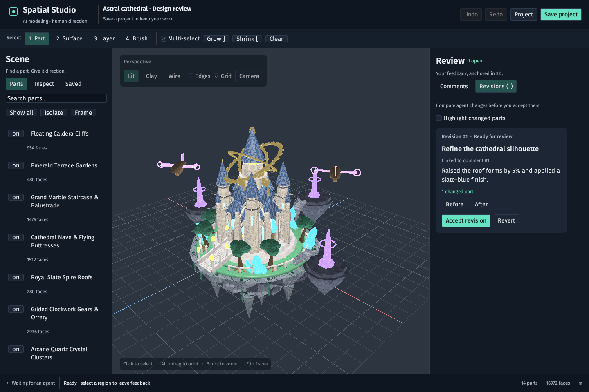
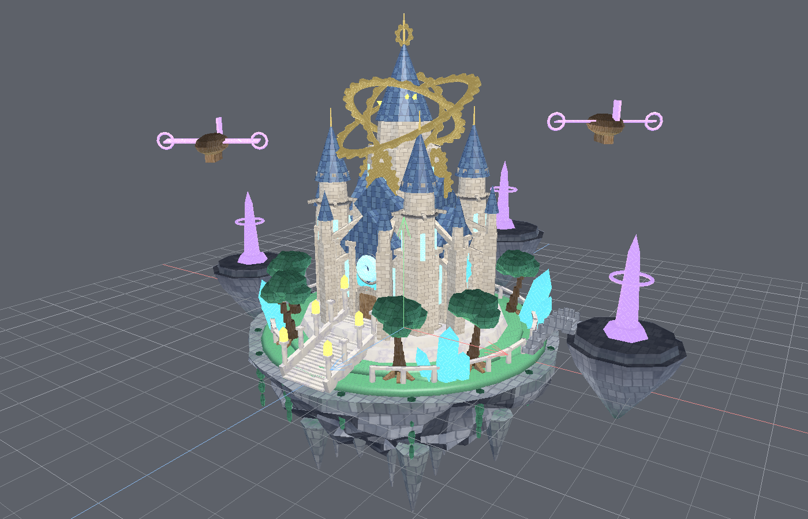

# 🤖 Rust AI 3D Modeler & Spatial Review Studio (`rust_modeler`)

An **AI-driven 3D Modeling, Voxel Sculpting & Spatial Review Studio** written in Rust (`wgpu` + `egui` + `winit`), featuring a built-in **Model Context Protocol (MCP) server** (`rust_modeler --mcp`) and an interactive **Smart Section Selection & Spatial Commenting GUI**.

Instead of forcing users to manually extrude vertices or wrestle with complex 3D gizmos, **Rust AI 3D Studio** implements an **AI-Agent-Driven 3D Workflow**:
1. **The AI Agent builds, sculpts, textures, and renders the 3D model** via MCP tools (`add_primitive`, `add_lathe`, `add_sweep`, `boolean`, `mirror_object`, `array_object`, `edit_mesh` incl. `bevel`, `sculpt_stroke`, `voxel_brush`, `voxel_remesh`, `set_material`, `capture_viewport`, `import_model`, `export_model`).
2. **The User inspects the 3D scene in the live GUI**, selects one or more **connected parts**, **crease-bounded surfaces**, **whole layers**, **painted regions** or **boxed areas**—even across multiple objects at once—and writes **Spatial 3D Comments** (or **Scene comments**), optionally with reference images. Comments wait as drafts until the user presses **Send to agent**.
3. **Any AI Agent (Claude Code, OpenAI Codex, Google Antigravity, Cursor)** waits with `wait_for_feedback`, activates the user's exact 3D face selections via `select_comment_region`, applies the requested changes inside a revision, verifies them with `capture_viewport` / `capture_studio`, and submits the revision with `finish_revision`. The user compares (including a draggable before/after split), accepts, or requests changes—which reopens the comment and wakes the agent again.


## Spatial Studio review workspace

The studio has a single slim header (project menu, command search, undo/redo, save), a searchable scene outliner with Parts/Inspect/Saved tabs and per-part colour swatches, and separate Comments and Revisions tabs. Viewport tools float over the 3D view: a vertical tool strip (selection modes, measure, fly, frame, shortcuts), a context bar with the active tool's options, view controls (shading, edges, grid, ghosting, section plane, camera), an orientation gizmo you can click to look along an axis, and a selection chip with grow / shrink / comment / clear. Selected parts glow with a teal rim and selected faces are tinted and outlined. The viewport has a studio backdrop and a soft contact shadow. Icons come from Phosphor (`egui-phosphor`); typography uses embedded Fira Sans (licence in `assets/fonts/OFL.txt`).

- **Command palette:** `Ctrl+K` (or the search box in the header) runs any command by name: selection modes, views, shading, overlays, save/open/export, send to agent, and more.

- **Projects:** Project → Save/Open uses `.spatial.json` files containing geometry, comments, camera, saved selections/views, and revision history. Bulk geometry arrays are stored as compressed base64 blocks inside the JSON, finished revisions keep only the parts they changed, and only the two most recent reviewed revisions keep geometry (older ones keep their summary). Older projects are migrated on load: a 331 MB project became 34 MB and loads about ten times faster. Saves are atomic and retain a `.bak` copy. Named projects also write `.autosave` recovery files; Project → Recover autosave restores one. `Ctrl/Cmd+S` saves.
- **Feedback batches:** New comments are drafts until you press **Send to agent** (or turn on **Send immediately**). Drafts are hidden from `get_comments`, so an agent never acts on a half-written thought. Attach reference images by dropping image files on the window, by path (paperclip), or with a viewport snapshot (camera); agents get their absolute paths in `attachments`.
- **Review:** Comments move through Open → In progress → Ready for review → Accepted. Replies stay with the comment. Revisions offer Before / Split / After comparison (drag the divider to wipe between them), changed-part highlighting, screenshot evidence, Accept, **Request changes** (reverts and posts your notes as a reply, reopening the comment for the agent), and Revert. Comparisons do not modify live geometry. Finish or cancel an in-progress revision before opening another project; review submitted work before making further geometry changes.
- **Reliable targets:** Targets include topology fingerprints and face signatures. Unchanged faces can be remapped after index changes. Ambiguous or replaced regions are marked **Needs reattachment**; select a replacement and choose Attach current selection. Legacy spatial comments without fingerprints also require reattachment rather than guessing. Disconnected selected islands within one object remain separate targets.
- **Inspection:** Search parts, double-click to frame, isolate every selected object, save selections and camera views, ghost unselected geometry, or inspect interiors with a movable X/Y/Z section plane. Clipped-away surfaces cannot intercept picking.
- **Measurements:** Inspect & measure lets you pick two points for distance or three for an angle at the middle point. Display units are meters, centimeters, millimeters, or inches; world coordinates remain meters. Attach measurements and dimension constraints to feedback.
- **Agent activity:** Expensive live operations run in a background worker. The review panel shows the current operation, elapsed time, errors, and recent activity. Cancel discards the pending result without changing live geometry; the underlying computation may finish in the background. Cancel revision restores the geometry from before the whole revision.
- **Undo:** Named revisions group agent geometry operations into one undo step. Undo preserves newer comments in the same project. The in-memory undo stack is session-local; persisted pending revisions can also be reverted after restarting.

Example project in the new review workspace:



### Agent revision protocol

```text
wait_for_feedback { since_batch? }        # blocks until the user sends comments
select_comment_region { comment_id }
begin_revision { label, comment_id }
... geometry / sculpt / material operations ...
capture_viewport { path }
finish_revision { revision_id, summary, screenshots: [path] }
wait_for_feedback { since_batch: <feedback_batch from the last call> }
```

`wait_for_feedback` polls the editor (or the headless scene file) every half second, so the GUI never blocks. It returns the open comments plus `feedback_batch`; pass that number back as `since_batch` to wait for the next batch. It also wakes when the user requests changes on a revision. On timeout it returns `woke: false`; call it again.

The user reviews the result in the Revisions tab. `accept_revision`, `revert_revision`, `cancel_revision`, `get_revisions`, `preview_revision`, `update_comment`, `reattach_comment`, `save_project`, `open_project`, and `cancel_operation` are also available through MCP and `--cmd`. The legacy `resolve_comment` tool remains available for comments without a revision. A live editor error or timeout is returned to the caller; commands are not silently replayed headlessly against an older live editor.

Generate an offscreen screenshot of the actual interface without changing the open scene:

```bash
cargo run --offline -- --preview-studio /tmp/spatial-studio.png
# Add --review-tab for revisions, or --project /path/to/project.spatial.json.
```

`capture_studio` exposes the same UI capture over MCP, with configurable dimensions and tab (`0` comments, `1` revisions). Pass `compare_revision` (and optionally `split`) to capture a before/after wipe of a revision.

---

## 📸 Showcase: Clockwork Astral Cathedral & Floating Archipelago

Included out-of-the-box in [`assets/scenes/clockwork_astral_cathedral_scene.json`](assets/scenes/clockwork_astral_cathedral_scene.json) (~16,972 faces across 14 procedural & sculpted layers with tri-planar 3D shaders, emissive glow, and baked ambient occlusion / curvature wear):

| Wide Studio Render | Close-Up Architectural Detail |
| :---: | :---: |
|  |  |

---

## ✨ Key Features

### 1. 💬 AI-Driven Spatial Comment & Multi-Selection Workflow
- **Smart Selection Modes** (Viewport tool strip & Shortcuts `1`–`6` / `Tab`):
  - **`🧩 Sub-Part (1)`** *(Default)*: **1-click selects the entire connected 3D piece** under the cursor (e.g., a single tree, gear, column, flying buttress, crystal, step, or airship inside a multi-part layer). Uses 2mm spatial vertex welding (`Mesh::quantize_pos`) so faceted meshes with split vertices select cleanly as a single 3D piece.
  - **`📐 Smart Surface (2)`**: **1-click flood-fills a contiguous wall, roof slope, step top, or smooth surface** bounded by sharp edges (`Crease: 5°..85°` slider).
  - **`📦 Whole Layer (3)`**: **1-click selects all faces of the clicked object layer**.
  - **`Box (4 or Ctrl+C)`**: Drag a rectangle to select every *visible* face inside it (occlusion and the section plane are respected; enable **Select through** to include hidden faces). Drag more boxes to mark several places at once — with Multi-select on or Shift held each box adds, Ctrl+drag removes. Every separate patch becomes its own comment target, so the AI agent gets one anchor and bounding box per place. `Ctrl+C` toggles back to the previous mode.
- **Free-Fly Navigation (`` ` `` or the viewport's **Fly** button)**: Game-style noclip camera for moving through large scenes. The cursor is captured; the mouse looks around, `W A S D` / arrows move, `Q` / `E` (or `Space`) go down/up, `Shift` is fast, `Ctrl` slow, and the scroll wheel sets the speed. Click selects whatever is under the crosshair with the current selection mode. `Esc`, `` ` `` or right-click leaves fly mode, and the orbit pivot moves to the surface you were looking at.
- **Live 3D Hover Preview**: Hovering over any part in `Sub-Part`, `Smart Surface`, or `Whole Layer` mode lights up the candidate selection in **electric cyan wireframe** before you click.
- **Multi-Selection for a Single Comment (`➕ Multi-Select`)**:
  - With `➕ Multi-Select` enabled (default), clicking multiple sub-parts or surfaces—**even across completely different object layers**—accumulates them into a single selection. Clicking an already-selected sub-part toggles it off.
  - Each selected section displays a **green 3D Pin Beacon** in the viewport and appears in the Right Panel's **Selected Sections** list with individual `✖` remove buttons.
  - Submitting a comment creates a `SpatialComment` containing `targets: Vec<CommentTargetSection>` with exact per-object `selected_faces`, 3D `world_anchor` / `local_anchor` coordinates, `surface_normal`, and local bounding boxes (`local_bounds_min` / `local_bounds_max`).
- **General Scene Comments (`🌐 Add General Comment`)**: Leave high-level instructions affecting the entire 3D model without pinning a specific surface.
- **Topological Grow / Shrink (`]` / `[`, or the selection chip)**: Expand or contract any face selection by one ring of neighboring faces.

### 2. 🎨 Tri-Planar 3D Procedural Shaders, Emissive Materials & Vertex Baking
- **8 Real-Time WGSL Tri-Planar 3D Procedural Patterns** (`src/shader.wgsl` — no UV unwrapping required):
  - `none` (Solid / Vertex Color)
  - `checker` (3D Checkerboard Tiles)
  - `bricks` (Staggered Masonry Bricks with Mortar Grooves)
  - `stone_blocks` (Ashlar Castle Stone Blocks with Per-Block Variation)
  - `wood_grain` (Concentric Timber Rings & Fibrous Grain)
  - `marble` (Turbulent Veined Marble)
  - `hex_grid` (Arcane / Sci-Fi Hexagonal Lattice)
  - `rune_circuit` (Glowing Concentric Rune & Circuit Channels)
- **Automatic Mesh Ambient Occlusion & Curvature Edge Wear (`bake_ao_and_curvature`)**:
  - Computes per-vertex concavity/convexity from neighbor umbrellas and bakes dark crevice shading + highlighted worn ridges into vertex colors.
- **Directional Top-Coat & Height Gradient Painting (`paint_gradient_and_normal_coat`)**:
  - Automatically coats upward-facing normals (moss, snow, dust, gold trim) and vertical height gradients.
- **Emissive Glow (`emission_color`, `emission_strength`)**:
  - Full HDR-style emissive glow for lanterns, crystals, portals, and arcane rings.

### 3. 🔨 Polygonal Mesh Modeling, Dynamic-Topology Sculpting & SDF Voxel Engine (via MCP)
- **Polygonal Mesh Engine (`src/mesh.rs`)**:
  - Primitives: `cube`, `sphere`, `cylinder`, `plane`, `torus`, `voxel_sphere`.
  - Operations (`edit_mesh`): `extrude`, `inset`, `bevel` (chamfer the border of the selected region), `subdivide` (Catmull-Clark style quad/tri subdivision), `translate_selected`, `scale_selected`, `rotate_selected`, `delete_selected`, `select_by_normal`, `select_all`, `clear_selection`.
- **Higher-level modeling (`src/modeling.rs`)**:
  - `boolean`: BSP-tree CSG union / subtract / intersect between two parts (windows, holes, grooves, joins). Only the overlap region is clipped, and non-overlapping parts are joined directly, so results stay light.
  - `mirror_object`: reflect a part across a local axis, merged into the same mesh or as a new part.
  - `array_object`: linear, radial or spiral repeats (offset + rotation + scale per step), as separate parts or one mesh.
  - `add_lathe`: revolve a `[radius, height]` profile into vases, columns, bowls, finials.
  - `add_sweep`: sweep a round or custom cross-section along a 3D path for rails, pipes, branches, handles, mouldings (twist and taper supported).
- **3D Surface Sculpting + Dynamic Topology (`src/voxel.rs`)**:
  - Brushes (`sculpt_stroke`): `draw`, `inflate`, `smooth`, `flatten`, `grab`, `pinch`, `crease` with X/Y/Z mirror symmetry and **Dyntopo** automatic local edge-split tessellation.
- **Volumetric SDF Voxel Engine (`src/voxel.rs`)**:
  - CSG operations (`voxel_brush`): `add_sphere`, `subtract_sphere`, `add_box`, `subtract_box`, `smooth_field`, `paint_color`.
  - Dual meshing modes: **Smooth Dual Surface Nets** (`smooth`) and **Blocky Voxel Cubes** (`blocky`), plus arbitrary-mesh **Voxel Remeshing** (`voxel_remesh`).
- **Headless & Live Viewport Screenshot Rendering (`capture_viewport`)**:
  - Renders the 3D scene via `wgpu` to a `.png` file so AI agents can visually inspect their work from any camera angle.
- **Import / Export (`.obj`, `.stl`, `.glb` glTF 2.0)**:
  - Full round-trip import and export in [`src/io.rs`](src/io.rs).
- **Texture baking for game export (`bake_texture`)**:
  - Models here carry their painted detail as vertex colours on dense meshes, which a game cannot afford. With `bake_texture` (the **Bake colours into a texture** switch in both export dialogs) a `.glb` export simplifies every part by edge collapse towards `max_triangles`, leaves out faces that cannot be seen, unwraps what is left and stores the colours in one PNG inside the file (`TEXCOORD_0` + base colour texture instead of `COLOR_0`).
  - `texture_size` (1024, 2048 or 4096) is the largest texture allowed; a smaller one is written when it already holds all the painted detail. Identical parts share texture space, one-colour surfaces share a small swatch, and the rest get texels in proportion to how finely they are painted.
  - Shapes are not simplified past recognition: when the budget is smaller than the model allows, the export stops there and says so in `warnings`. Parts only hide each other's faces in a merged export; separate parts stay complete so they can be moved in the game. See [`src/bake.rs`](src/bake.rs).
  - Use a vertex-colour export to reimport painted models into this studio. Baked textures are intended for Godot and Blender.

---

## 🚀 Quick Start

### Build & Run
```bash
# Run all unit tests
cargo test

# Launch the interactive 3D Studio GUI
cargo run
```

### Connect an AI Coding Agent via MCP

#### 1. Claude Code
This repository includes a root [`.mcp.json`](.mcp.json) and [`CLAUDE.md`](CLAUDE.md). When you open this directory in **Claude Code**, it will automatically detect the `rust-modeler` MCP server, or you can register it explicitly:
```bash
claude mcp add rust-modeler -- cargo run --quiet --manifest-path "/path/to/repo/Cargo.toml" -- --mcp
```

#### 2. OpenAI Codex / Cursor / Windsurf
Read [`AGENTS.md`](AGENTS.md) (automatically loaded by Codex and compatible agents). You can invoke any MCP tool either over stdio (`cargo run --quiet -- --mcp`) or directly from the shell via `--cmd`:
```bash
./target/debug/rust_modeler --cmd '{"tool":"get_comments","args":{}}'
./target/debug/rust_modeler --cmd '{"tool":"get_scene_info","args":{}}'
```

#### 3. Google Antigravity
Includes a pre-packaged Antigravity plugin in [`.agents/plugins/rust-modeler-mcp/`](.agents/plugins/rust-modeler-mcp/).

---

## 🛠 Complete MCP Tool Reference

| Tool Name | Purpose | Key Arguments |
| :--- | :--- | :--- |
| `get_scene_info` | Inspect all objects, transforms, materials, vertex/face counts, `unresolved_comments`, and `active_selection` | *(none)* |
| `wait_for_feedback` | Block until the user sends comments (or requests changes), then return the open comments and `feedback_batch` | `since_batch?: int`, `timeout_seconds?: float` |
| `get_comments` | List sent spatial & general comments, including `targets` (multi-part selections), 3D anchors, face indices and `attachments` (reference image paths) | `include_resolved?: bool`, `include_drafts?: bool` |
| `send_comments` | Send all draft comments as one batch (the GUI's Send to agent) | *(none)* |
| `clear_selection` | Clear face selections, the selected part and the focused comment (do this before review screenshots) | *(none)* |
| `request_changes` | Revert a ready revision and reopen its comment with the user's notes | `revision_id: int`, `notes?: string` |
| `select_comment_region` | Highlight all `targets` (`selected_faces`) of a `comment_id` and focus the camera | `comment_id: int`, `focus_camera?: bool` |
| `resolve_comment` | Mark a `comment_id` resolved and attach an `agent_reply` explaining the changes made | `comment_id: int`, `resolved?: bool`, `reply?: string` |
| `add_comment` | Programmatically add a spatial section comment or general scene comment | `comment: string`, `is_general?: bool`, `object_id?: int`, `local_point?: [x,y,z]`, `radius?: float` |
| `capture_viewport` | Render the 3D viewport to a PNG image file for AI visual self-inspection | `path?: string`, `width?: int`, `height?: int`, `yaw_deg?: float`, `pitch_deg?: float`, `distance?: float`, `target?: [x,y,z]`, `shading?: string`, `frame?: string` (`scene` \| `selection` \| `object` \| `comment`), `comment_id?: int` |
| `launch_gui_window` | Spawn the live 3D Modeler GUI window if not already open | *(none)* |
| `clear_scene` | Remove all objects from the scene (undoable) | *(none)* |
| `add_primitive` | Add a `cube`, `sphere`, `cylinder`, `plane`, `torus`, or `voxel_sphere` | `shape: string`, `name?: string`, `size?: float`, `radius?: float`, `height?: float`, `subdivisions?: int`, `position?: [x,y,z]`, `rotation_deg?: [x,y,z]`, `scale?: [x,y,z]`, `color?: [r,g,b]` |
| `transform_object` | Move, rotate, scale, rename, or show/hide an object | `object_id?: int`, `name?: string`, `position?: [x,y,z]`, `translate_delta?: [x,y,z]`, `rotation_deg?: [x,y,z]`, `scale?: [x,y,z]`, `new_name?: string`, `visible?: bool` |
| `set_material` | Set PBR material, 3D procedural shader `pattern`, emissive glow, and bake vertex AO / edge wear / top-coat | `object_id?: int`, `color?: [r,g,b]`, `secondary_color?: [r,g,b]`, `roughness?: float`, `metallic?: float`, `flat_shading?: bool`, `pattern?: string`, `texture_scale?: float`, `emission_color?: [r,g,b]`, `emission_strength?: float`, `bake_ao?: bool`, `ao_strength?: float`, `wear_strength?: float`, `top_coat_color?: [r,g,b]` |
| `boolean` | CSG between two parts; the target keeps the result, the tool part is removed unless `keep_tool` | `object_id?: int`, `tool_object_id: int`, `operation: string` (`union` \| `subtract` \| `intersect`), `keep_tool?: bool` |
| `mirror_object` | Mirror a part across a local axis | `object_id?: int`, `axis: string`, `merge?: bool` |
| `array_object` | Repeat a part with a per-step offset / rotation / scale | `object_id?: int`, `count: int`, `offset?: [x,y,z]`, `rotation_deg?: [x,y,z]`, `scale?: float`, `merge?: bool` |
| `add_lathe` | Revolve a `[radius, height]` profile around Y | `profile: [[r,h],...]`, `segments?: int`, `angle_deg?: float`, `cap?: bool`, `name?`, `color?`, `position?` |
| `add_sweep` | Sweep a cross-section along a path | `path: [[x,y,z],...]`, `radius?: float`, `sides?: int`, `profile?: [[x,y],...]`, `closed?: bool`, `cap?: bool`, `twist_deg?: float`, `end_scale?: float`, `name?`, `color?`, `position?` |
| `edit_mesh` | Polygonal mesh modeling on selected faces or faces matching a normal | `object_id?: int`, `operation: string` (`extrude`, `inset`, `bevel`, `subdivide`, `translate_selected`, `scale_selected`, `rotate_selected`, `delete_selected`, `select_by_normal`, `select_all`, `clear_selection`, `bridge`, `fill_holes`, `weld`, `flip_normals`, `smooth`, `subdivide_smooth`, `decimate`), `select_faces?: int[]`, `select_faces_by_normal?: [x,y,z]`, `distance?: float`, `inset_factor?: float`, `width?: float` (bevel), `delta?: [x,y,z]` |
| `query_geometry` | Read real geometry: world bounds and size, per-face centre / normal / area, connected regions of the selection | `object_id?: int`, `scope?: string` (`object` \| `selection` \| `faces`), `faces?: int[]`, `max_faces?: int`, `include_vertices?: bool` |
| `measure` | Gap, overlap and distance between two parts, or the length along points | `object_id?: int`, `other_object_id?: int`, `points?: [[x,y,z],...]` |
| `check_mesh` | Holes, flipped / inside-out faces, zero-area faces, overlapping and isolated parts, with the fix for each | `object_id?: int` |
| `select_faces` | Select faces by box, sphere, connected piece, surface, normal, similarity, path, invert, grow or shrink | `mode: string`, `op?: string` (`replace` \| `add` \| `subtract`), `object_id?: int`, `min?`, `max?`, `center?`, `radius?`, `seed_face?: int`, `normal?`, `by?: string` |
| `add_mesh` | Create a part from raw vertices and polygon faces (no `.obj` round trip) | `vertices: [[x,y,z],...]`, `faces: [[i,...],...]`, `vertex_colors?`, `name?`, `color?`, `position?` |
| `add_extrude` | Raise a 2D outline into a solid, with optional taper and twist | `profile: [[x,z],...]`, `height: float`, `top_scale?: float`, `twist_deg?: float`, `segments?: int`, `cap?: bool` |
| `add_loft` | Skin a surface through cross-section rings | `sections: [[[x,y,z],...],...]`, `cap?: bool`, `closed?: bool` |
| `deform_object` | Bend, twist or taper a part or its selected faces | `mode: string`, `axis?: string`, `toward?: string`, `angle_deg?: float`, `factor?: float` |
| `align_object` | Line a part up with another, stack it, or rest it on the ground | `object_id?: int`, `target_object_id?: int`, `x?` / `y?` / `z?`: `min` \| `center` \| `max` \| `before` \| `after` \| `ground`, `gap?: float` |
| `scatter_object` | Spread copies of a part over another part's surface (seeded) | `object_id?: int`, `target_object_id: int`, `count?: int`, `seed?: int`, `scale_min?`, `scale_max?`, `min_normal_y?: float`, `merge?: bool` |
| `paint_faces` | Colour only the selected (or listed) faces of a part | `color: [r,g,b]`, `object_id?: int`, `faces?: int[]`, `blend?: float` |
| `capture_views` | Render several angles into one contact-sheet PNG | `path?: string`, `views?: string[]`, `frame?: string` (`scene` \| `selection` \| `object` \| `comment`), `comment_id?: int`, `cell_width?: int`, `cell_height?: int` |
| `batch` | Run many tool calls in one round trip | `commands: [{tool, args}]`, `stop_on_error?: bool` |
| `sculpt_stroke` | Apply 3D sculpting brush (`draw`, `inflate`, `smooth`, `flatten`, `grab`, `pinch`, `crease`) with optional `dyntopo` | `object_id?: int`, `brush: string`, `point?: [x,y,z]`, `points?: [[x,y,z],...]`, `radius?: float`, `strength?: float`, `symmetry_x?: bool`, `dyntopo?: bool` |
| `voxel_brush` | Volumetric SDF CSG (`add_sphere`, `subtract_sphere`, `add_box`, `subtract_box`, `smooth_field`, `paint_color`) | `object_id?: int`, `operation: string`, `point?: [x,y,z]`, `points?: [[x,y,z],...]`, `radius?: float`, `color?: [r,g,b]`, `meshing_mode?: string` (`smooth` \| `blocky`) |
| `voxel_remesh` | Remesh any object into uniform topology at a target voxel grid resolution | `object_id?: int`, `resolution?: int` (`12..64`) |
| `set_camera_and_viewport` | Orbit/zoom camera, place a first-person camera (`eye` + `look_at`), set view preset (`front`, `right`, `top`), or switch shading (`lit`, `clay`, `wireframe`) | `target?: [x,y,z]`, `distance?: float`, `yaw_deg?: float`, `pitch_deg?: float`, `eye?: [x,y,z]`, `look_at?: [x,y,z]`, `preset?: string`, `shading?: string`, `wireframe_overlay?: bool`, `show_grid?: bool` |
| `import_model` / `export_model` | Import or export `.obj`, `.stl`, or `.glb` (glTF 2.0) files. `.glb` export is game-ready for Godot and Blender: named nodes, materials, vertex colours, optional merging, collision shapes, a triangle budget and texture baking (`bake_texture`: low-poly mesh with UVs and one embedded colour texture, so painted detail survives the budget) | `path: string`, `name?: string`, `color?: [r,g,b]`; `.glb` export: `merge?: bool`, `collision?: string` (`none` \| `box` \| `convex` \| `part_boxes` \| `mesh`), `max_triangles?: int`, `bake_texture?: bool`, `texture_size?: int` (1024 \| 2048 \| 4096), `origin?: string` (`keep` \| `base`), `scale?: float`, `target?: string` (`godot` \| `blender`), `root_name?`, `all?` / `object_ids?` / `names?` / `group?` / `selection?` |
| `undo` / `redo` | Step backward or forward through the undo history | *(none)* |
| `library_list` | List the asset library (sections > subsections > assets) shared by every project | `section?: string`, `search?: string` |
| `library_show` | Open the full library view in the GUI | *(none)* |
| `library_save_asset` | Save the whole model (`all: true`) or chosen parts as one reusable asset; without `all` / `object_ids` / `names` / `group` the current selection is saved | `name: string`, `section: string`, `subsection?: string`, `all?: bool`, `object_ids?: [int]`, `names?: [string]`, `group?: string`, `description?`, `tags?: [string]`, `overwrite?: bool`, `thumbnail?: bool` |
| `library_insert_asset` | Add a copy of an asset to the scene, base centre at `position` | `asset: string` (`Section/Subsection/Name` or a unique name), `position?: [x,y,z]`, `rotation_y_deg?: float`, `scale?: float` |
| `library_export` | Export library assets as `.glb` files for Godot (snake_case names, merged parts, optional collision; reports each `res://` path) or Blender (original names, separate parts) | `directory: string`, `asset?: string`, `section?`, `subsection?`, `target?: string` (`godot` \| `blender`), `collision?: string`, `merge?: bool`, `max_triangles?: int`, `bake_texture?: bool`, `texture_size?: int`, `scale?: float` |
| `library_create_section` / `library_delete_section` | Create a section or subsection; delete an empty one | `section: string`, `subsection?: string` |
| `library_move_asset` / `library_delete_asset` | Move or rename an asset; delete moves it to the library's `.trash` folder | `asset: string`, `section?`, `subsection?`, `name?` |

---

## 📂 Architecture Overview

See [`AGENTS.md`](AGENTS.md) for a deep dive into every module, data structure, IPC protocol, and workflow for AI agents.
